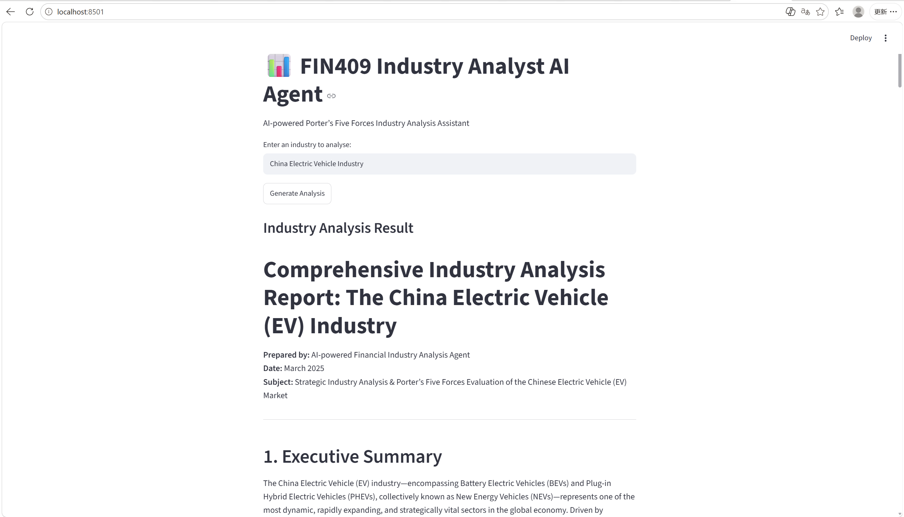

# FIN409 Industry Analyst AI Agent
## Demo Screenshot



## Overview

This project develops an AI-powered industry analysis assistant using Google Gemini and Streamlit.

The agent generates a Porter's Five Forces analysis for different industries to support strategic and financial analysis.

## Features

- Analyse any industry entered by users
- Generate AI-powered Porter's Five Forces analysis
- Provide structured industry insights:
  - Industry overview
  - Competitive rivalry
  - Threat of new entrants
  - Supplier power
  - Buyer power
  - Threat of substitutes
  - Strategic implications


## Technology Stack

| Component | Technology |
|---|---|
| Programming Language | Python |
| User Interface | Streamlit |
| AI Model | Google Gemini 3.5 Flash Lite |
| Analysis Framework | Porter's Five Forces |


## How to Run

Install required packages:

```bash
pip install -r requirements.txt


## Project Structure

```
FIN409_AI_Agent/
│
├── app.py              # Streamlit user interface
├── agent.py            # Gemini AI agent logic
├── prompt.txt          # System prompt for Porter’s Five Forces
├── requirements.txt    # Python dependencies
├── screenshot.png      # Demo screenshot
└── README.md           # Project documentation
```


## How to Run

### 1. Install required packages

```bash
pip install -r requirements.txt
```

### 2. Configure Gemini API Key

Create a `.env` file in the project folder:

```bash
GOOGLE_API_KEY=your_api_key_here
```

### 3. Run the application

```bash
streamlit run app.py
```

The application will open automatically in your browser.